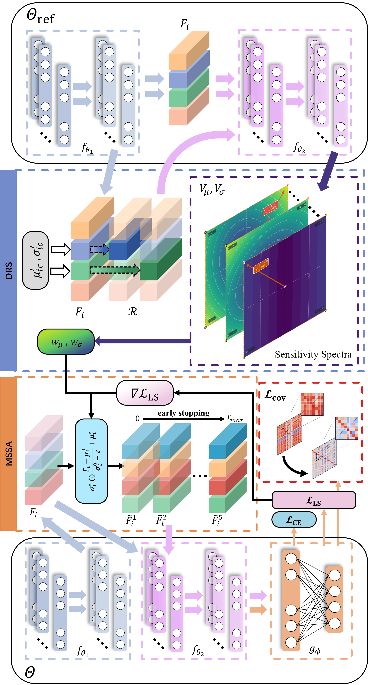

# SAReL: Sensitivity-Guided Adversarial Feature Augmentation for Single-Domain Generalization in Fault Diagnosis

This repository provides the core PyTorch implementation of **SAReL**.

## Introduction

We study single-domain generalization for fault diagnosis, where a model trained under a single operating condition is expected to generalize to unseen conditions. SAReL uses **Deep Representation Sensitivity (DRS)** to assess channel-wise sensitivity to feature-statistic changes and guide **Multi-Step Statistical Adversarial Search (MSSA)** in generating challenging feature augmentations. A joint regularization strategy combining **Cross-Covariance Decorrelation Loss (CCDL)** and label smoothing encourages representation consistency and reduces cross-dimensional redundancy.

  

## Prerequisites

- PyTorch >= 2.0
- NumPy >= 1.24

Install dependencies with `pip install -r requirements.txt`.

## Code

This repository contains the core algorithm only. Dataset preprocessing, full training, and evaluation pipelines are not included.

## Citation

Citation information will be added after publication.
